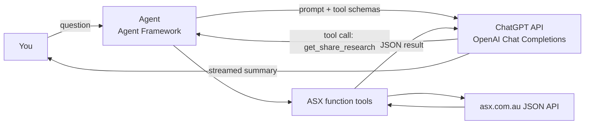

# ASX Share Query

A command-line agent built with **Microsoft Agent Framework** and the **ChatGPT API**
(OpenAI). DeepSeek works too - see [Configuration](#configuration).

Ask it about an ASX-listed share in plain English and it goes to the ASX, pulls the price
snapshot and the company's latest announcements, then summarises what is going on.

```text
You: What's happening with BHP?

Agent: BHP Group (ASX: BHP) last traded at A$61.05, up A$0.84 (+1.40%) on 17.1M shares,
with a market cap of about A$306.1B in the Materials sector.

Recent announcements (headline only - the ASX feed returns headlines, not document text):
- 15 Sep 2026 [Periodic Reports] BHP 2026 ESG Roundtable
- 14 Sep 2026 [Notice of Meeting] BHP 2026 Notice of Annual General Meeting
- 14 Sep 2026 [Security Holder Details] Change of Director's Interest Notice
- 06 Sep 2026 [Distribution Announcement] Update - Dividend/Distribution - BHP
(None of these were flagged price-sensitive.)

What this might mean:
- ...
Read the filings yourself: https://www.asx.com.au/markets/company/BHP

This is a delayed snapshot of public information, not financial advice.
```

## How it works



Microsoft Agent Framework is model-agnostic and ships an OpenAI-compatible client, so the
model vendor is just a `base_url` plus a bearer token: the ChatGPT endpoint goes in as-is,
and DeepSeek only needs its own `base_url`. The agent decides for itself when to call the
ASX tools and how to combine what comes back.

## Requirements

- Python 3.10 or newer (the framework requires it)
- A ChatGPT API token: <https://platform.openai.com/api-keys> (or a
  [DeepSeek key](https://platform.deepseek.com/api_keys) instead)

This project manages Python itself with [uv](https://docs.astral.sh/uv/), which installs
into `~/.local/bin` and needs no admin rights.

```bash
curl -LsSf https://astral.sh/uv/install.sh | sh
uv python install 3.12
```

## Setup

```bash
uv sync                 # create .venv and install dependencies
uv sync --extra web     # ...plus the browser chat window
u sync --extra streamlit  # ...or the Streamlit chat page
cp .env.example .env    # then put your ChatGPT API token in .env
```

`.env`:

```bash
OPENAI_API_KEY=sk-...
```

`.env` is git-ignored. The token is never logged: startup output shows only a redacted form.

## Usage

```bash
uv run asx-sharequery            # interactive chat
uv run python -m asx_sharequery  # same thing
```

Type a question, get a streamed answer, and keep asking follow-ups - the session retains
the conversation. `exit` (or Ctrl-D) quits.

Ask a single question and exit (works from any terminal, even a non-interactive one):

```bash
uv run asx-sharequery "What's happening with BHP?"
```

### Chat window in the browser

Prefer a chat window to the terminal? Microsoft Agent Framework ships **DevUI**, which
serves this agent as a browser UI with streaming replies, conversation history and a live
panel showing every tool call:

```bash
uv sync --extra web
uv run asx-sharequery-web          # opens http://127.0.0.1:8000
```

It needs no Azure account and no bot registration. Two things to know:

- DevUI describes itself as a **sample app, and not for production use**. It is also a
  beta release, which is why the `web` extra is opt-in rather than a core dependency.
- `--port`, `--host`, `--no-open` are available; `uv run asx-sharequery-web --help` lists
them. The server binds to localhost only by default.

**About authentication.** DevUI's access token is disabled for a localhost bind and
forced on when you bind a wider interface, because its browser UI has no way to supply
the token (it documents it only for direct API calls, and the server never prints it), so
leaving it on locally just breaks the chat window with `401`. Binding wider without
`--auth` is refused outright.

### Hosted chat window (Streamlit)

There is also a Streamlit front-end, `streamlit_app/app.py`, which is what the Community
Cloud deployment runs:

```bash
uv sync --extra streamlit
uv run streamlit run streamlit_app/app.py    # opens http://localhost:8501
```

It streams the answer as it arrives, and each turn's tool calls collapse into a summary
line under the reply. The hosted deployment differs from the local one in a single,
deliberate way: **document reading is switched off**, because a public URL cannot tell its
visitors apart and the SharePoint tool reads your organisation's library with app-only
credentials. See **[DEPLOY_STREAMLIT_CLOUD.md](DEPLOY_STREAMLIT_CLOUD.md)** for the deploy
steps and the rest of the notes that go with a public app.

Example prompts:

- `What's happening with BHP?`
- `Summarise the latest news for Commonwealth Bank`
- `How is CSL trading today?`
- `Any announcements from WES this week?`

### Helper scripts

```bash
uv run python scripts/smoke_test.py CBA     # checks the ASX data layer (no API key needed)
uv run python scripts/check_agent.py "What's happening with A2M?"   # one end-to-end question
```

## Project layout

```text
src/asx_sharequery/
  config.py       settings from .env / environment
  asx_client.py   async client for the public ASX JSON API
  news_client.py  async client for the Google News RSS feed
  sharepoint_client.py  app-only Microsoft Graph reader + PDF/Word text extraction
  tools.py        the function tools the model can call
  agent.py        model client + agent instructions
  preflight.py    startup check that the provider accepts the token
  cli.py          interactive streaming chat loop
  webui.py        optional browser chat window (DevUI)
scripts/
  smoke_test.py   live data-layer checks
  check_agent.py  single end-to-end question
streamlit_app/
  app.py              Streamlit chat page - the Community Cloud entrypoint
  requirements.txt    dependency file for the cloud build
.streamlit/
  secrets.toml.example  template for local secrets (the real secrets.toml is git-ignored)
DEPLOY_STREAMLIT_CLOUD.md   deploy guide for Streamlit Community Cloud
```

## The tools

| Tool | What it returns |
| --- | --- |
| `get_share_research` | Price snapshot **and** recent announcements. The main entry point. |
| `get_share_snapshot` | Price only: last price, change, bid/ask, volume, market cap, sector, trading status. |
| `get_share_announcements` | Announcements only: date, type, headline, price-sensitivity flag. |
| `get_share_news` | Third-party media headlines from Google News: outlet, date, link. |
| `read_sharepoint_library` | Text of the PDF and Word documents in your SharePoint library. |

Tools never raise. A bad code comes back as an `{"error": ...}` payload so the agent can
tell you what went wrong, or ask you to confirm the ticker, instead of crashing the run.
Both ASX requests for `get_share_research` are issued concurrently.

The four ASX tools need no credentials at all. `read_sharepoint_library` is the only one
that does, so it is the only one the hosted Streamlit deployment leaves out - see
**[DEPLOY_STREAMLIT_CLOUD.md](DEPLOY_STREAMLIT_CLOUD.md)**.

## Reading a SharePoint library

The agent can read PDF and Word documents from a SharePoint document library and summarise
them in one pass. Ask something like *"summarise the documents in my SharePoint library"*.

### Setup

This uses **app-only** authentication (OAuth 2.0 client credentials), so nothing signs in
interactively and it can run unattended.

1. In the [Entra admin centre](https://entra.microsoft.com): **App registrations -> New
   registration**. Any name works; no redirect URI is needed.
2. Copy the **Application (client) ID** and **Directory (tenant) ID**.
3. **Certificates & secrets -> New client secret**. Copy the secret *value* immediately -
   it is shown only once.
4. **API permissions -> Add a permission -> Microsoft Graph -> Application permissions ->
   `Sites.Read.All`**, then click **Grant admin consent**. A tenant admin has to do this;
   it cannot be self-granted, and without it every call returns HTTP 403.
5. Fill in `.env`:

```bash
SHAREPOINT_TENANT_ID=...
SHAREPOINT_CLIENT_ID=...
SHAREPOINT_CLIENT_SECRET=...
SHAREPOINT_SITE_URL=https://contoso.sharepoint.com/sites/Research
SHAREPOINT_LIBRARY=Documents
```

`SHAREPOINT_LIBRARY` is the library's **display name**, usually `Documents`. If it does not
match, the tool replies listing the libraries it can see, so a typo is easy to correct.

### How it works

The Microsoft Graph calls are made with `httpx`, not the Microsoft SDKs. This is
deliberate: `azure-identity`, `msal` and `msgraph-sdk` all depend on `cryptography`, whose
recent releases publish no CPython wheels for Intel macOS, so installing them here triggers
a Rust source build. Client-credentials needs none of that - it is a form post and a bearer
token. Text extraction follows the same principle: `.docx` is parsed from its underlying
zip with the standard library, and only `.pdf` needs a package (`pypdf`, pure Python).

### Limitations

- **PDF and Word only.** Other file types are skipped, and the tool says so rather than
  silently ignoring them.
- **No OCR.** A scanned PDF has no text layer, so it comes back empty and the tool flags
  the file as needing OCR.
- **Truncated to fit the model.** 8 documents at 6000 characters each by default; the
  agent is told to say when it truncated something. Ask for fewer documents if you need
  more depth.
- **`Sites.Read.All` is broad.** App-only access grants the app read access to *every*
  site in the tenant, not just this library. `Sites.Selected` scopes it to specific sites
  but requires extra setup. Treat the client secret like a password - it is in `.env`,
  which is git-ignored and excluded from the zip.

## Data sources and limitations

Data comes from the public JSON services behind `asx.com.au` (no API key, no HTML
scraping) plus the public Google News RSS feed. Being unofficial, they can change without
notice, so responses are parsed defensively.

- **Only the five most recent announcements.** The endpoint ignores paging parameters and
  always returns five. The tools state this rather than pretending otherwise.
- **No announcement deep links.** The feed's `url` field is empty and there is no working
  public link per document, so tools return the ASX company page (`source_url`) instead.
  Nothing fabricates a PDF URL.
- **Headlines, not documents.** The tools do not download or read the PDFs, so the agent
  describes headlines and is instructed never to claim it read the filing.
- **Snapshot, not a live feed.** Prices come from the same delayed data the website shows.
- **No company-name search.** The ASX exposes no public search endpoint, so the agent maps
  a company name to its code itself and asks you to confirm when unsure.
- **Ticker format.** Codes are normalised, so `bhp`, `BHP` and `bhp.ax` all work. Unknown
  codes get an HTTP 400 from the ASX, which is surfaced as "the ASX does not list that
  code".
- **Media coverage is third-party, and headlines only.** `get_share_news` queries Google
  News and returns headlines, outlets, dates and links - never article text, which is not
  fetched. Results are filtered for relevance because tickers like `ALL`, `MIN` and `SUN`
  are also ordinary English words and sector words like "Resources" spread across a whole
  sector.
- **No retail forums.** HotCopper is deliberately not a source. It blocks automated
  access (every page returns 403 behind Cloudflare bot protection) and its `robots.txt`
  disallows `GPTBot` outright, so scraping it would mean defeating an access control the
  site put there on purpose. If you ask what retail investors are saying, the agent says
  it cannot read those sources and offers media coverage instead.

The agent is explicitly instructed not to give buy/sell/hold recommendations or price
targets.

## Configuration

Whichever token is present decides the provider. ChatGPT is tried first, so dropping an
`OPENAI_API_KEY` into `.env` is the whole setup; configure both and set `LLM_PROVIDER` to
pick one.

| Variable | Default | Purpose |
| --- | --- | --- |
| `OPENAI_API_KEY` | *(required)* | Your ChatGPT API token. |
| `OPENAI_BASE_URL` | `https://api.openai.com/v1` | Any OpenAI-compatible endpoint. |
| `OPENAI_MODEL` | `gpt-4o-mini` | Chat Completions model that supports function calling. |
| `DEEPSEEK_API_KEY` | *(alternative)* | Use DeepSeek instead of OpenAI. |
| `DEEPSEEK_BASE_URL` | `https://api.deepseek.com/v1` | DeepSeek endpoint. |
| `DEEPSEEK_MODEL` | `deepseek-chat` | DeepSeek model that supports function calling. |
| `LLM_PROVIDER` | *(auto)* | `openai` or `deepseek`, to override the auto-detection. |

The `base_url` variables mean any other OpenAI-compatible host (Azure OpenAI, a local
server, a proxy) can be used by pointing them at it.

At startup the app probes `GET /models` once to confirm the token is accepted, and prints
why not if it is rejected. An unreachable provider is ignored rather than fatal, so being
offline never blocks startup.

### OpenAI token: use a Platform API key

`OPENAI_API_KEY` must be an `sk-...` **Platform API key** from
<https://platform.openai.com/api-keys>. A ChatGPT or Codex *sign-in* token does not work:
the Codex CLI authenticates against a different, subscription-scoped surface, and sending
that credential to `api.openai.com` returns
`401 rejected_by_access_enforcement`. Those tokens are also short-lived and rotate on
sign-in, so they cannot be pinned in `.env` even if they were accepted.

## Troubleshooting

**The browser chat window returns 401** - you are likely running DevUI directly with its
default auth settings. Use `uv run asx-sharequery-web`, which handles this.

**`CLIENT_ERROR: Entity not found: agent_in_memory_...`** - the URL in the address bar
still carries the `entity_id` of a previous run. DevUI registers the agent in memory and
generates that id anew each time the server starts, so a bookmarked or restored tab stops
resolving after a restart. Open <http://127.0.0.1:8000> without a query string, or just
reload the page.

**It prints `Bye.` straight away** - the terminal had no interactive input (its stdin was
already closed), so there was nothing to type into. That happens when a program is
launched by a tool, a task or with redirected input rather than typed into a terminal
panel. The CLI now detects this and explains it instead of exiting quietly. Fix it by
opening a fresh terminal with **Ctrl+`** and running the command there, or use the
one-shot form: `uv run asx-sharequery "How is BHP trading?"`.

**`No model API token is set`** - create `.env` and add `OPENAI_API_KEY=sk-...`, or
`export OPENAI_API_KEY=sk-...`.

**401 Authentication Fails** - the token is wrong, expired or out of credit. The endpoint
is fine: a 401 from the provider proves the wiring works.

**`401 rejected_by_access_enforcement` / `no_matching_rule`** - the value in
`OPENAI_API_KEY` is a ChatGPT or Codex sign-in token, not a Platform API key; see
[OpenAI token](#openai-token-use-a-platform-api-key). Create an `sk-...` key, or set
`LLM_PROVIDER=deepseek`.

**`Unknown LLM_PROVIDER` or `model_not_found`** - `LLM_PROVIDER` must be `openai` or
`deepseek`, and `OPENAI_MODEL` must name a model your account can call (and that supports
Chat Completions function calling - the GPT-5 and o-series reasoning models use a different
request shape).

**`certificate verify failed`** on macOS - the system Python often ships without CA
certificates. Use the project's interpreter (`uv run ...`), not `python3`.

**Why is `agent-framework` not a dependency?** This project depends on
`agent-framework-core` + `agent-framework-openai` rather than the `agent-framework`
meta-package. The meta-package pulls `agent-framework-core[all]`, which drags in ~30
provider integrations plus `mcp` → `pyjwt[crypto]` → `cryptography`. Recent `cryptography`
releases publish no CPython wheels for Intel macOS, so installs would try to build Rust
from source. The slim packages are all the ChatGPT and DeepSeek APIs need and install
cleanly everywhere.
